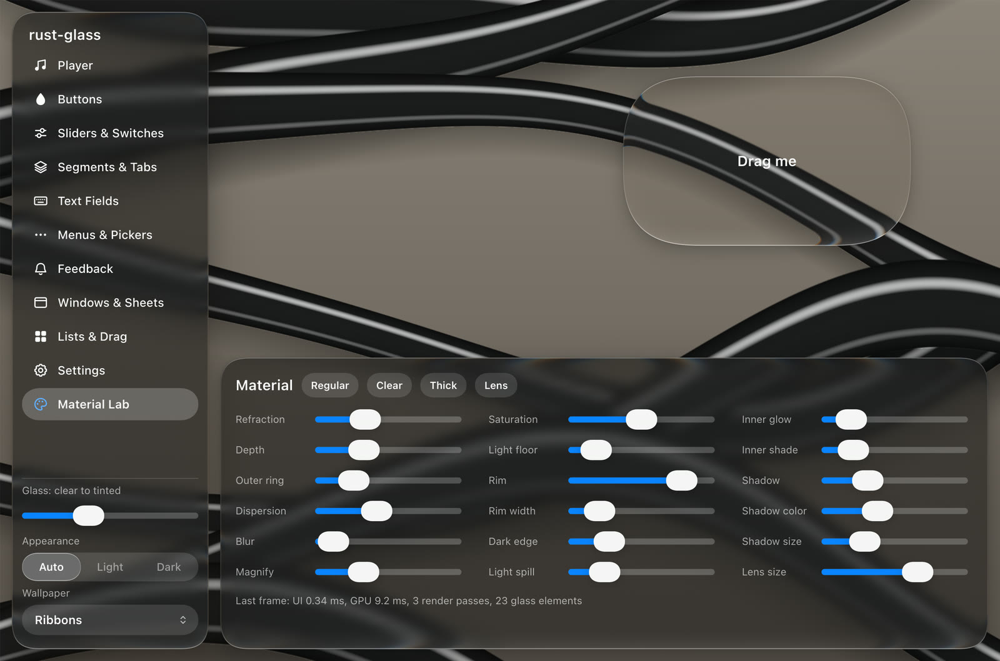
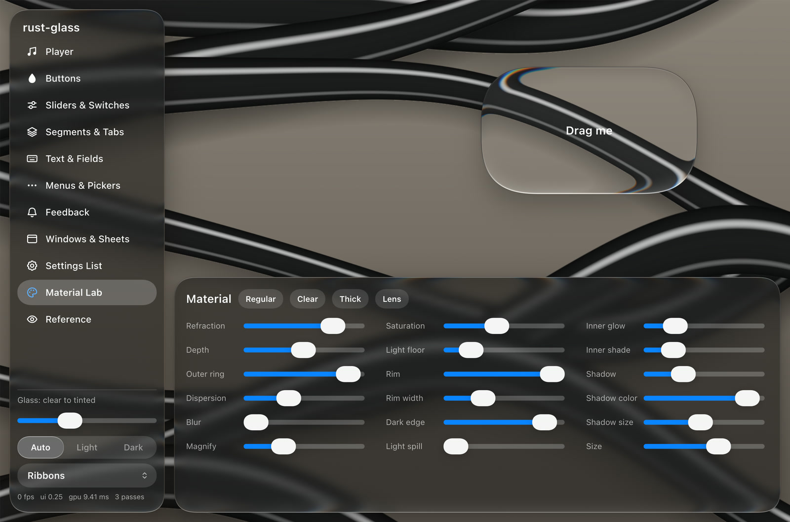
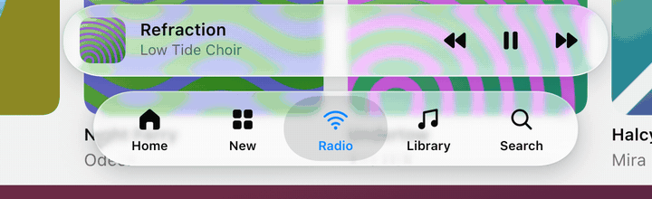
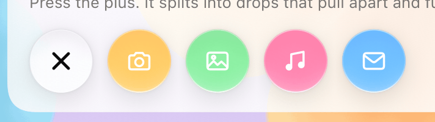

# rust-glass

A GPU rendered UI framework for Rust in the style of Apple's Liquid Glass. Controls bend, blur and color the pixels behind them in real time, including other controls. The API is immediate mode and will look familiar if you know egui.

Read the [guide](https://github.com/MasterKPG/rust-glass/blob/main/crates/rust-glass/GUIDE.md) to build an app with it.





The selection of a tab bar lifts into a clear blob:



The thumb of a slider lifts into a lens and changes shape with acceleration:


The + button splits into drops that pull apart and fuse again:



More pictures are in the [preview](https://github.com/MasterKPG/rust-glass/tree/main/preview) folder: [player](https://github.com/MasterKPG/rust-glass/blob/main/preview/player.jpg), [dark player](https://github.com/MasterKPG/rust-glass/blob/main/preview/player-dark.jpg), [buttons](https://github.com/MasterKPG/rust-glass/blob/main/preview/buttons.jpg), [sliders and switches](https://github.com/MasterKPG/rust-glass/blob/main/preview/sliders.jpg), [segments and tabs](https://github.com/MasterKPG/rust-glass/blob/main/preview/segments.jpg), [text fields](https://github.com/MasterKPG/rust-glass/blob/main/preview/fields.jpg), [menus](https://github.com/MasterKPG/rust-glass/blob/main/preview/menu.jpg), [feedback](https://github.com/MasterKPG/rust-glass/blob/main/preview/feedback.jpg), [windows](https://github.com/MasterKPG/rust-glass/blob/main/preview/windows.jpg), [settings](https://github.com/MasterKPG/rust-glass/blob/main/preview/settings.jpg), and the lab on [regular](https://github.com/MasterKPG/rust-glass/blob/main/preview/lab-regular.jpg) and [thick](https://github.com/MasterKPG/rust-glass/blob/main/preview/lab-thick.jpg) glass and over a [test grid](https://github.com/MasterKPG/rust-glass/blob/main/preview/lab-grid.jpg).

## Features

- Lens with refraction, chromatic dispersion and edge mirroring, computed from a signed distance field per pixel
- Specular rim, dark edge, inner glow and a shadow that carries the color of the light passing through
- Small glass elements measure their backdrop on the GPU and switch between light and dark with hysteresis
- Shapes in one element fuse like drops of liquid
- Every motion is a closed form spring: interruptible and independent of the frame rate
- Press response that swells and stretches towards the finger
- Slider, switch and tab bar thumbs lift into lenses whose shape follows acceleration
- A transparency setting from ultra clear to tinted that also controls how clear the lifted lenses are, plus reduced transparency, reduced motion and increased contrast
- Keyboard focus and operation for the interactive controls
- Draws only on change. An idle window uses no CPU

Components: button (regular, prominent, tinted, clear, plain, icon, group, splitting), slider, stepper, drag value, switch, checkbox, radio, segmented control, tab bar, text field, search field, password field, multi line editor, menu, combo box, context menu, color picker, progress bar, gauge, spinner, tooltip, toast, alert, modal, sheet, window, panel, navigation list, scroll area, collapsing section, settings row, table, card, image, link.

## Install

Needs Rust 1.90 or newer and a GPU with Vulkan, DirectX 12 or Metal.

```bash
cargo add rust-glass
```

The API docs are on [docs.rs](https://docs.rs/rust-glass). To follow the main branch instead of the releases, use `cargo add rust-glass --git https://github.com/MasterKPG/rust-glass`.

## Usage

```rust
use rust_glass::prelude::*;

struct Hello {
    volume: f32,
    wifi: bool,
}

impl App for Hello {
    fn update(&mut self, ctx: &mut Context, _: &FrameInfo) {
        // Something colorful for the glass to bend.
        let screen = ctx.screen;
        ctx.background().gradient(screen.expand(64.0), 0.0, Color::INDIGO, Color::ORANGE, vec2(0.5, 0.5));

        let panel = Rect::from_center_size(screen.center(), vec2(360.0, 220.0));
        Panel::new("main", panel).padding(22.0).show(ctx, |ui| {
            ui.heading("Hello");
            ui.slider(&mut self.volume, 0.0..=1.0);
            ui.toggle(&mut self.wifi, "Wi-Fi");
            if ui.prominent_button("Reset").clicked() {
                self.volume = 0.5;
            }
        });
    }
}

fn main() -> Result<(), String> {
    run(Options::default(), Hello { volume: 0.3, wifi: true })
}
```

Glass belongs on floating controls and bars. Put it above images or scrolling content to see it work. A button placed on a glass panel draws as a fill, because glass on glass muddies both.

The [guide](https://github.com/MasterKPG/rust-glass/blob/main/crates/rust-glass/GUIDE.md) covers layout, every widget, menus and dialogs, images, theming, materials, custom widgets, animation, testing and common problems.

## Run the showcase

Every component on one screen, with a live material editor.

```bash
git clone https://github.com/MasterKPG/rust-glass
cd rust-glass
cargo run --release -p showcase
```

Drop an image file on the window to use it as wallpaper. Render all pages to PNG without a window, with timings:

```bash
cargo run --release -p showcase -- --capture captures
```

`--preview DIR` renders the pictures of the preview folder the same way. Run the tests with `cargo test --workspace`.

## How the glass works

1. The scene is drawn into an offscreen texture. Before a pass with glass, the region behind it is copied and reduced into a mip chain.
2. The glass shader evaluates a superellipse distance field. Near the outline, samples move inwards along the normal with the profile of a quarter circle bevel, and red moves further than blue.
3. Blur is a bicubic lookup between two mip levels, so its radius can animate. The result is remapped to a light or dark range and tinted.
4. Rim, dark edge, inner glow and shadow come from the same distance and normal.
5. Draw commands that do not overlap move to the earliest possible pass. A page with 28 glass elements takes 3 passes.

egui was the first choice of base. It paints in one render pass, so a widget cannot read the pixels of widgets below it, and existing egui glass refracts a pre-registered image instead. That is why this is a separate framework.

## Performance

Measured with `--capture` at 1770 x 1170 on an Intel UHD integrated GPU (i5-1345U, Vulkan), release build: 0.2 to 0.4 ms of UI code and 3 to 6 ms of GPU time per frame, depending on the page. The first frame is drawn about 0.3 s after start, including loading the system fonts.

## Project structure

```text
crates/rust-glass/GUIDE.md
crates/rust-glass/src
  gpu/         renderer and WGSL shaders
  material.rs  glass parameters and presets
  paint.rs     draw lists
  ui.rs        layout
  context.rs   input routing, animation memory, backdrop measurements
  widgets/     components
examples/showcase
scripts/       versioning for the release workflow
preview/       pictures of the showcase
```

## Releases

A push to main that changes the crate or this README is tested, versioned and published by a [workflow](https://github.com/MasterKPG/rust-glass/blob/main/.github/workflows/release.yml). Breaking changes, found by cargo-semver-checks, raise the minor version and everything else the patch. The workflow commits the new version, turns the Unreleased section of the [changelog](https://github.com/MasterKPG/rust-glass/blob/main/CHANGELOG.md) into the release notes, publishes to [crates.io](https://crates.io/crates/rust-glass) and creates a [GitHub release](https://github.com/MasterKPG/rust-glass/releases). To choose a version by hand, set it in `Cargo.toml` and name the changelog section after it.

## Status

Early. Windows with Vulkan is the only platform tested so far. See [ROADMAP.md](https://github.com/MasterKPG/rust-glass/blob/main/ROADMAP.md) and [TODO.md](https://github.com/MasterKPG/rust-glass/blob/main/TODO.md).

Contributions are not open.

## License

Licensed under either of [Apache License 2.0](https://github.com/MasterKPG/rust-glass/blob/main/LICENSE-APACHE) or [MIT](https://github.com/MasterKPG/rust-glass/blob/main/LICENSE-MIT), at your option.

rust-glass is an independent project and not affiliated with Apple. It contains no Apple code, fonts, icons or images.
