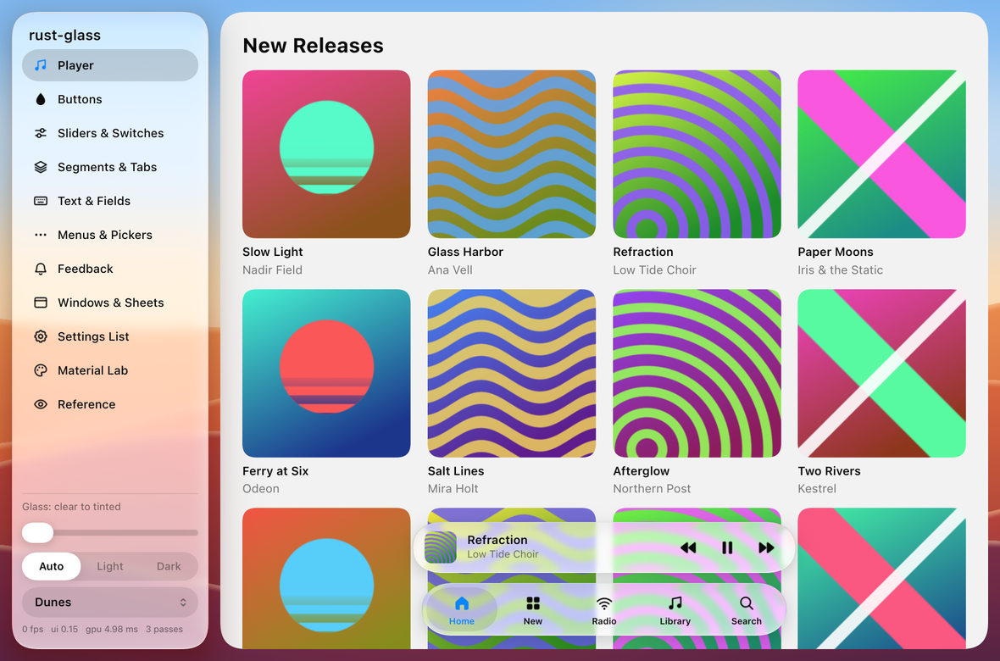

# rust-glass

A GPU rendered UI framework for Rust in the style of Apple's Liquid Glass. Controls bend, blur and color the pixels behind them in real time, including other controls. The API is immediate mode and will look familiar if you know egui.



## Features

- Lens with refraction, chromatic dispersion and edge mirroring, computed from a signed distance field per pixel
- Specular rim, dark edge, inner glow and a shadow that carries the color of the light passing through
- Small glass elements measure their backdrop on the GPU and switch between light and dark with hysteresis
- Shapes in one element fuse like drops of liquid
- Every motion is a closed form spring: interruptible and independent of the frame rate
- Press response that swells, stretches towards the finger and lights up from the point of contact
- A transparency setting from clear to tinted, plus reduced transparency, reduced motion and increased contrast
- Keyboard focus and operation for the interactive controls
- Draws only on change. An idle window uses no CPU

Components: button (regular, prominent, tinted, clear, plain, icon, group, splitting), slider, stepper, drag value, switch, checkbox, radio, segmented control, tab bar, text field, search field, password field, multi line editor, menu, combo box, context menu, color picker, progress bar, gauge, spinner, tooltip, toast, alert, modal, sheet, window, panel, navigation list, scroll area, collapsing section, settings row, table, card, image, link.

## Run the showcase

Needs Rust 1.90 or newer and a GPU with Vulkan, DirectX 12 or Metal.

```bash
cargo run --release -p showcase
```

Drop an image file on the window to use it as wallpaper. Render all pages to PNG without a window, with timings:

```bash
cargo run --release -p showcase -- --capture captures
```

## Usage

The crate is not published. Add it as a path dependency.

```rust
use rust_glass::prelude::*;

struct Hello {
    volume: f32,
    wifi: bool,
}

impl App for Hello {
    fn update(&mut self, ctx: &mut Context, _: &FrameInfo) {
        let screen = ctx.screen.shrink(24.0);
        region(ctx, "main", screen, |ui| {
            ui.heading("Hello");
            ui.slider(&mut self.volume, 0.0..=1.0);
            ui.toggle(&mut self.wifi, "Wi-Fi");
            if ui.prominent_button("Reset").clicked() {
                self.volume = 0.5;
            }
        });
    }
}

fn main() {
    run(Options::default(), Hello { volume: 0.3, wifi: true }).unwrap();
}
```

Glass belongs on floating controls and bars. Put it above images or scrolling content to see it work. A button placed on a glass panel draws as a fill, because glass on glass muddies both.

## How the glass works

1. The scene is drawn into an offscreen texture. Before a pass with glass, the region behind it is copied and reduced into a mip chain.
2. The glass shader evaluates a superellipse distance field. Near the outline, samples move inwards along the normal with the profile of a quarter circle bevel, and red moves further than blue.
3. Blur is a bicubic lookup between two mip levels, so its radius can animate. The result is remapped to a light or dark range and tinted.
4. Rim, dark edge, inner glow and shadow come from the same distance and normal.
5. Draw commands that do not overlap move to the earliest possible pass. A page with 28 glass elements takes 3 passes.

egui was the first choice of base. It paints in one render pass, so a widget cannot read the pixels of widgets below it, and existing egui glass refracts a pre-registered image instead. That is why this is a separate framework.

## Performance

Measured with `--capture` at 1770 x 1170 on an Intel UHD integrated GPU (i5-1345U, Vulkan), release build: 0.15 to 0.35 ms of UI code and 3 to 7 ms of GPU time per frame, depending on the page. The window appears about 110 ms after start.

## Project structure

```text
crates/rust-glass/src
  gpu/         renderer and WGSL shaders
  material.rs  glass parameters and presets
  paint.rs     draw lists
  ui.rs        layout
  context.rs   input routing, animation memory, backdrop measurements
  widgets/     components
examples/showcase
```

## Status

Early. Windows with Vulkan is the only platform tested so far. See [ROADMAP.md](ROADMAP.md) and [TODO.md](TODO.md).

Contributions are not open.
