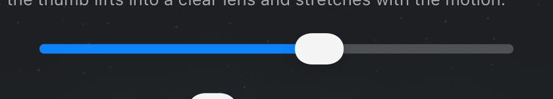

# rust-glass

A Rust UI framework that draws controls in the style of Apple's Liquid Glass on the GPU. Glass bends, blurs and tints whatever is behind it, including other glass. The API is immediate mode, like egui.


The tab bar selection lifts into a clear blob while you drag it:


The slider thumb turns into a lens and stretches with the motion:



The + button splits into drops that pull apart and fuse again:


More pictures are in the [preview folder](https://github.com/MasterKPG/rust-glass/tree/main/preview).

## Features

- Refraction, color dispersion, blur, rim light and a shadow that takes the color of the light passing through
- Small glass elements measure what is behind them and switch between light and dark
- Shapes of one element fuse like drops of liquid
- All motion runs on springs, so it can be interrupted at any time and looks the same at any frame rate
- Elements morph from one view into another, and content comes into focus as menus, dialogs and pages appear
- Settings for glass tint, reduced transparency, reduced motion and increased contrast
- Keyboard focus, and screen reader support through [AccessKit](https://accesskit.dev)
- Scrolling on one or two axes, and lists of any length that only lay out the visible rows
- Drag and drop, and lists that reorder by dragging
- Text fields with undo, redo and input method support
- Draws only when something changes. An idle window uses no CPU

Widgets: buttons, button groups, split button, slider, stepper, drag value, switch, checkbox, radio button, segmented control, tab bar, text fields, menus, combo box, context menu, color picker, progress bar, gauge, spinner, tooltip, toast, alert, modal, sheet, window, panel, navigation list, settings row, scroll area, drag source, drop zone, reorderable list, collapsing section, table, card, image and link.

## Install

You need Rust 1.90 or newer and a GPU with Vulkan, DirectX 12 or Metal.

```bash
cargo add rust-glass
```

To try the version in development: `cargo add rust-glass --git https://github.com/MasterKPG/rust-glass --branch dev`.

## Example

```rust
use rust_glass::prelude::*;

struct Hello {
    volume: f32,
    wifi: bool,
}

impl App for Hello {
    fn update(&mut self, ctx: &mut Context, _: &FrameInfo) {
        // Glass needs something behind it to bend.
        let screen = ctx.screen;
        ctx.background().gradient(screen.expand(64.0), 0.0, Color::INDIGO, Color::ORANGE, vec2(0.5, 0.5));

        let panel = Rect::from_center_size(screen.center(), vec2(360.0, 220.0));
        Panel::new("main", panel).padding(22.0).show(ctx, |ui| {
            ui.heading("Hello");
            ui.slider(&mut self.volume, 0.0..=1.0);
            ui.toggle(&mut self.wifi, "Wi-Fi");
            if ui.prominent_button("Reset").clicked() {
                self.volume = 0.5;
            }
        });
    }
}

fn main() -> Result<(), String> {
    run(Options::default(), Hello { volume: 0.3, wifi: true })
}
```

The [guide](https://github.com/MasterKPG/rust-glass/blob/main/crates/rust-glass/GUIDE.md) explains layout, every widget, menus and dialogs, images, theming, materials, your own widgets, animation and testing. The API reference is on [docs.rs](https://docs.rs/rust-glass).

## Showcase

The showcase has a page for every group of widgets and a lab to edit the glass material live.

```bash
git clone https://github.com/MasterKPG/rust-glass
cd rust-glass
cargo run --release -p showcase
```

Drop an image on the window to use it as the wallpaper. To render every page to PNG without a window and print timings, run `cargo run --release -p showcase -- --capture captures`.

## How the glass is drawn

1. The scene is drawn into a texture. Before a pass with glass, the area behind the glass is copied and scaled down into a chain of smaller copies for blurring.
2. A shader computes the distance to the outline of each glass shape. Near the outline it samples the backdrop further inwards, along the curve of a rounded bevel. Red bends a little more than blue.
3. Blur mixes two levels of the scaled copies, so its radius can animate smoothly.
4. Rim light, edge, glow and shadow come from the same distance.
5. Draws that do not overlap share a pass. A page with 28 glass elements needs 3 passes.

egui was the first choice as a base, but it paints everything in one pass, so a widget cannot see the widgets below it. That is why rust-glass is its own framework. A renderer that draws egui apps with glass widgets is planned, see the [roadmap](https://github.com/MasterKPG/rust-glass/blob/main/ROADMAP.md#egui-integration).

## Performance

On an Intel UHD integrated GPU (i5-1345U, Vulkan) at 1770 by 1170 pixels, a frame takes 0.2 to 0.4 ms of UI code and 3 to 6 ms on the GPU, depending on the page. The first frame shows about 0.3 seconds after start.

## Platforms

- Windows: tested by hand on Vulkan and DirectX 12.
- macOS (Metal) and Linux (Vulkan): every push runs the tests and renders every page in CI. The renders match Windows except for the text, which uses each platform's own font.
- Screen readers: tested with Windows UI Automation. VoiceOver and Orca have not been tried yet.

The project is early. Plans are in [ROADMAP.md](https://github.com/MasterKPG/rust-glass/blob/main/ROADMAP.md). Contributions are not open.

## License

MIT or Apache-2.0, at your option: [LICENSE-MIT](https://github.com/MasterKPG/rust-glass/blob/main/LICENSE-MIT), [LICENSE-APACHE](https://github.com/MasterKPG/rust-glass/blob/main/LICENSE-APACHE).

rust-glass is an independent project, not affiliated with Apple. It contains no Apple code, fonts, icons or images.
